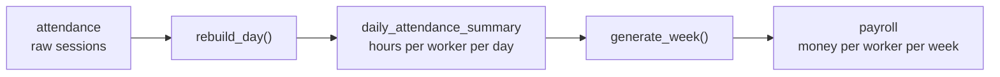
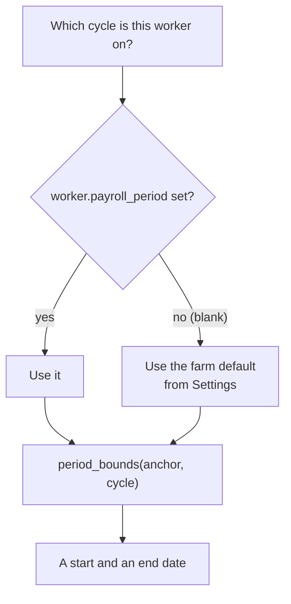
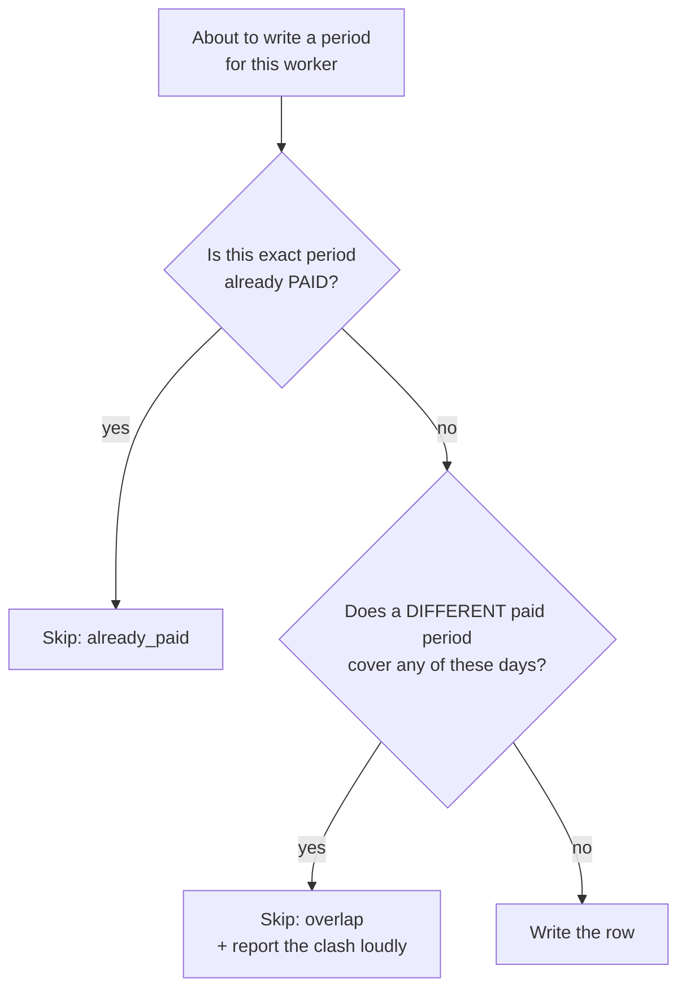
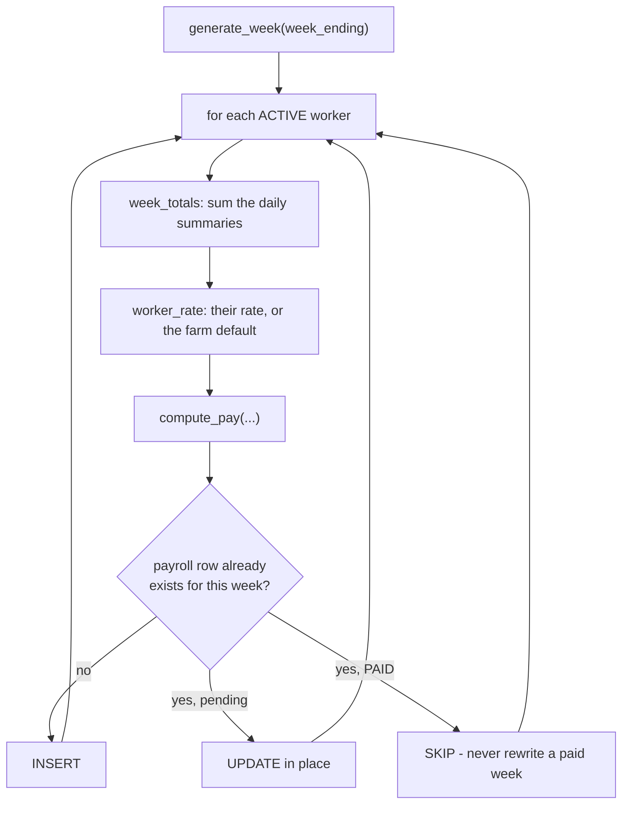
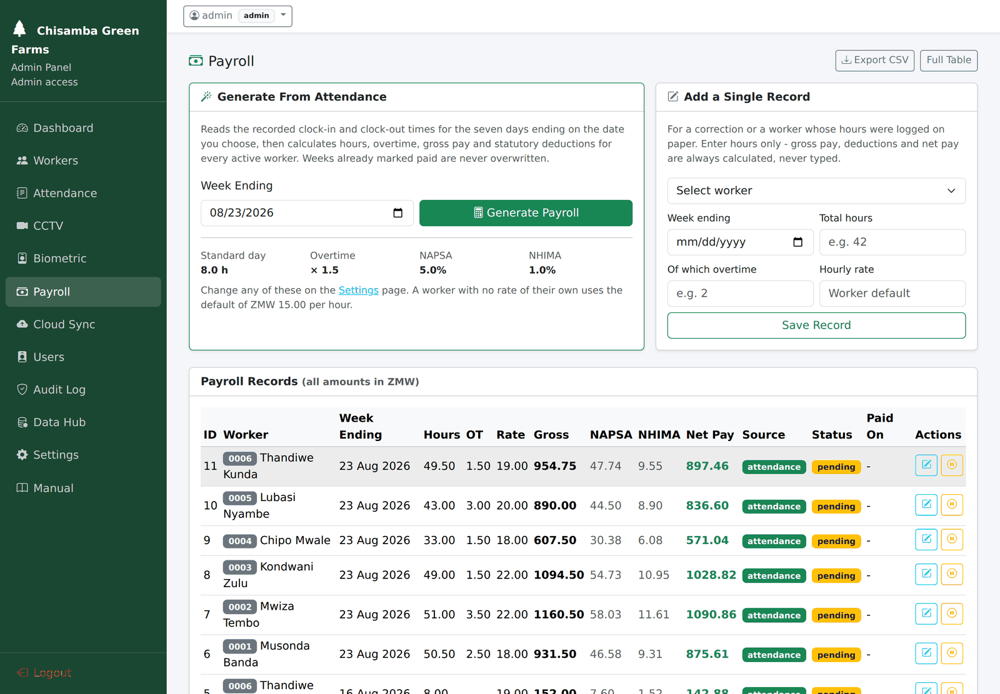

# `payroll_engine.py`

← [Module index](README.md) · [Wiki index](../README.md)

**~540 lines. Turns attendance rows into hours, and hours into money.**

---

## What it owns

| | |
| --- | --- |
| **Owns** | Daily summaries, the pay calculation, weekly generation, the trend series |
| **Does not own** | Recording attendance, displaying payslips |
| **Called by** | `attendance_service` (after each punch), `app.py`, `api.py` |

## The two-stage pipeline



**Reading this diagram:** raw clock-in and clock-out times go in on the left and
money comes out on the right, through two stages. The first turns times into
**hours per person per day**. The second turns those daily hours into **money per
person per week**.

> **Analogy: a shop's takings.** You do not add up every till receipt for the
> year in one go. You total each day, then add the days into a week. If one
> receipt turns out to be wrong, you re-total that one day — not the whole year.

Attendance rows are never read directly by payroll generation. Everything goes
through the summary table, which is what keeps weekly generation fast for two
hundred workers.

## Pay cycles

Four of them: **weekly**, **fortnightly**, **semi-monthly** and **monthly**. A
farm sets a default in Settings, and any individual worker can override it on
their own record — casual labour weekly and permanent staff monthly, on the same
farm, at the same time.



**Reading this diagram:** exactly the same shape as `worker_rate()` — one
worker-level value with a farm-level fallback. One idiom to learn, not two.

### How the date you pick is read

This differs by cycle, and the difference is not arbitrary:

| Cycle | The date you pick means |
| --- | --- |
| weekly | the **last day** — a farm can end its week on any day it likes |
| fortnightly | the **last day** |
| semi-monthly | **any day inside** the half-month; bounds snap to 1–15 or 16–end |
| monthly | **any day inside** the month; bounds snap to the calendar month |

A month ends when the calendar says so, not when somebody picks a date. Snapping
also means a clerk typing the 23rd gets September, rather than an error.

### Why this was cheap to add

**The arithmetic did not change at all.** `compute_pay()` takes hours and a rate
and has no idea what period they came from, and overtime is decided **per day**
in `rebuild_day()` against the standard *day*, never against the period. A
monthly run just sums thirty days of already-correct daily overtime instead of
seven.

> **Analogy: a till roll.** The daily totals are already printed down the strip.
> Choosing a pay period is only a decision about where to tear it.

### The period is recorded on the row, not just in Settings

`Payroll` carries `period_start` and `period_type` alongside `week_ending`
(which now means *period* ending — the additive-only migration cannot rename a
column). This is not bookkeeping for its own sake: a farm that switches from
weekly to monthly still has to be able to read last year's payslips, and a list
showing `875` next to `3,400` with no labels is one a worker will read as being
short-paid.

Rows written before cycles existed are backfilled as weekly on first start-up by
`app._backfill_payroll_periods()`.

## The overlap guard

`paid_overlap()` is the money-safety check, and it is the reason this feature is
more than a dropdown.



**Reading this diagram:** two separate questions. The first stops a settled
period being rewritten. The second stops a *different* settled period being paid
over the top of.

The case it exists for: a worker paid weekly has four settled weeks, then the
farm moves them to monthly. Generating the month would re-pay every one of those
days. Nothing else in the system would have noticed.

Only **paid** periods block — a pending row is provisional by definition. Legacy
rows with no `period_start` are treated as the weeks they were, their start
inferred as six days before their end.

## `rates()` — configuration, not constants

```python
DEFAULTS = {"standard_day_hours": 8.0, "overtime_multiplier": 1.5,
            "napsa_rate": 0.05, "nhima_rate": 0.01, ...}

def rates() -> dict:
    # reads the settings table, falling back to DEFAULTS
```

Every rate is a settings row. Statutory rates change by legislation and farms
differ; a farm should not need a developer when the pension rate is revised.

The statutory basis, so you know what the numbers mean:

| Setting | Default | Basis |
| --- | --- | --- |
| `napsa_rate` | 0.05 | NAPSA is 10% of earnings split equally, so **5% from the employee** |
| `nhima_rate` | 0.01 | NHIMA Act No. 2 of 2018: **1% employee**, matched by 1% employer |
| `standard_day_hours` | 8 | Operating convention |
| `overtime_multiplier` | 1.5 | Operating convention |
| `work_week` | `mon-sat` | The week most farms here run |
| `saturday_hours` | 4 | The half day |
| `lunch_start_time` / `lunch_minutes` | 13:00 / 60 | Unpaid break |

The last three, with the 07:00-16:00 shift, add up to the **44 hour week** the
system arrives configured for: five eight-hour days and a Saturday morning.

> **Not implemented:** pay-as-you-earn income tax, the NAPSA contribution
> ceiling, terminal benefits. The ceiling in particular means a high earner would
> currently be **over-deducted**. This is the most consequential outstanding item
> in the module and it should be fixed before the system pays anyone real money.

## The work schedule

Before any of the pay arithmetic is worth anything, something has to say which
hours are ordinary. For most of this project's life nothing did: there was a
single `standard_day_hours`, applied identically to all seven days.

That is wrong in two directions at once, and both are invisible on the page.

- A worker who put in **seven hours on a Saturday** earned no overtime, because
  seven is less than eight — even though the farm's Saturday is a half day.
- A worker who came in on a **Sunday** was treated as though it were an
  ordinary working day, and was additionally marked *late* for missing a shift
  that did not exist.

### `standard_hours_for(day, config)`

The one function that decides it.

```python
if weekday not in working_days(config):   return 0.0     # every hour is overtime
if weekday == SATURDAY:                   return saturday_hours or standard_day
return standard_day
```

A rest day returning **0** is the point, not an oversight. Somebody working
outside the schedule is working entirely outside it, and the multiplier is the
only thing that says so.

Note the `or` on the Saturday line. A blank `saturday_hours` means *a full
Saturday*, not *no Saturday*. A farm that works Saturdays in full should not
have to retype the standard day in a second box, and should certainly not be
able to zero its Saturdays by clearing a field that reads like a half-day option.

### `unpaid_break_hours(sessions, day, config)` — the overlap rule

Lunch is unpaid, and the deduction is the **overlap between each clocked-in
session and the lunch window** rather than a flat hour. That distinction is the
whole design:

| What the worker did | Overlap | Deducted | Why that is right |
| --- | --- | --- | --- |
| Clocked out 13:00, back in 14:00 | none | nothing | The break is already missing from their hours. A flat hour would charge them twice — and would punish the worker who used the clock honestly |
| Stayed clocked in 07:00-16:00 | one hour | one hour | The case a flat rule was written for |
| Short day ending 11:00 | none | nothing | They were not there |

The limit of the rule is worth stating plainly: attendance data records
*presence*, not whether a meal was eaten, so a worker who genuinely works
through lunch still has the hour deducted. A farm that pays worked lunches
records the extra time as overtime, or sets `lunch_minutes` to 0.

**Order matters.** The break comes off *before* overtime is computed. Otherwise
an hour at the table becomes an hour at time-and-a-half — 07:00 to 18:00 is ten
hours worked, two of them overtime, not three.

### `scheduled_end(day, standard, config)`

A half day finishes earlier than `shift_end_time`, and the earlier finish has
to be *derived* rather than looked up: shift start, plus the hours owed, plus
lunch only if lunch falls inside that span. Without it, every Saturday reads as
the entire workforce walking out four hours early.

## `rebuild_day(worker_pk, day)`

Recomputes one worker's summary for one day, **from scratch**.

```python
sessions = Attendance.query.filter(...).order_by(Attendance.check_in_time.asc()).all()

if not sessions:
    if summary:
        db.session.delete(summary)     # stale summary removed
    return None
```

What it computes: total hours from **closed** sessions only, overtime as hours
beyond the standard day, first in and last out, late minutes against the shift
start, early departure minutes, session count, and whether the day was face and
CCTV verified.

**Only closed sessions contribute hours.** Somebody currently clocked in shows
`total_hours = 0` with `sessions_count = 1`; their hours appear when they clock
out. That is correct — you cannot pay for a shift that has not ended.

**Rebuild, not increment.** Deleting and recomputing is slower (about 269 ms for
a fortnight, measured) and is the right trade: if a session is corrected later,
the summary corrects itself. An incrementing counter would stay wrong forever.

## `refresh_range(day_from, day_to, worker_pk=None)`

Rebuilds every day in a range, for one worker or all. Behind the *Rebuild Daily
Summaries* button on the Attendance page — the recovery path when sessions were
imported or edited directly.

## `week_bounds(week_ending)`

A payroll week is the **seven days ending on** `week_ending`, inclusive. One
place defines it so no caller can get the arithmetic subtly wrong.

## Pay bases — hourly, daily, monthly

A farm does not pay everybody the same way, and until these existed all three
kinds of worker had to be entered as an hourly rate. The consequence was not
cosmetic: **a salaried supervisor lost pay for a sick day**, because their
"salary" was a made-up hourly figure multiplied by hours they did not work.

| Basis | The rate means | Overtime |
| --- | --- | --- |
| `hourly` | per hour | hours beyond the day's schedule, at the multiplier |
| `daily` | per day | yes, priced at `rate / standard_day_hours` |
| `monthly` | per month | **none** |

### The column name is wrong, deliberately

`Worker.hourly_rate` now holds "the rate in whatever unit the basis names".
That is a wart, and it is the lesser of the options available:

- **Renaming it** is not possible. `migrations.py` is additive only — it issues
  `ALTER TABLE ADD COLUMN` and nothing else, by design, because a rename on
  SQLite means rebuilding the table and that is not a thing to do to a farm's
  only copy of its payroll.
- **Adding `daily_rate` and `monthly_salary`** would let one worker hold three
  rates at once with nothing in the schema saying which one counts. The first
  time two of them disagreed, no one could say which was right.

One rate, one basis, no ambiguity. The project already carries a comparable
wart in `pin_fingerprint`.

### `NULL` means hourly

Every worker on a database written before the column existed was being paid by
the hour. If `NULL` meant anything else, their pay would change the day the
farm upgraded — which is the one thing a migration must never do.

### Proration: 12/26 and 12/52, not 1/2 and 1/4

```python
"monthly": 1.0, "semi-monthly": 0.5,
"fortnightly": 12.0 / 26.0, "weekly": 12.0 / 52.0,
```

The obvious arithmetic is wrong. There are 26 fortnights and 52 weeks in a
year, not 24 and 48, so paying half a month every fortnight pays **thirteen
months' salary a year**. A test asserts that 26 fortnightly payments come to
exactly twelve months.

### A salary earns no overtime, and that is a refusal

Silently paying overtime on a salary is how a wage bill runs away. A farm that
pays salaried staff for extra hours pays it as an allowance, outside this
engine, where somebody has to decide it.

### A salaried worker with no attendance is still skipped

`skipped_no_hours` applies to every basis. A salary is not conditional on
hours, but it *is* conditional on the person being there, and a name on the
register with no attendance behind it for a whole month is precisely how a
ghost worker gets paid — in full, in this case.

### The basis is stored on the payroll row

`Payroll.pay_basis` and `Payroll.day_equivalents`, for the same reason
`napsa_rate` is stored per row: a payslip has to stay reproducible after the
worker moves from daily to salaried. Looking the basis up from the worker at
print time would silently rewrite history.

## `compute_pay(total_hours, overtime_hours, hourly_rate, config=None, pay_basis="hourly", day_equivalents=0.0, period_type=None)`

**The most important function in the module, and it is pure.** No database, no
request context, no Flask. Give it numbers, get numbers back.

```python
overtime_hours = round(min(max(0.0, float(overtime_hours or 0.0)), total_hours), 2)
regular_hours  = round(total_hours - overtime_hours, 2)

basic_pay    = round(regular_hours * rate, 2)
overtime_pay = round(overtime_hours * rate * config["overtime_multiplier"], 2)
gross_pay    = round(basic_pay + overtime_pay, 2)
napsa        = round(gross_pay * config["napsa_rate"], 2)
nhima        = round(gross_pay * config["nhima_rate"], 2)
net_pay      = round(gross_pay - napsa - nhima, 2)
```

The worked example from the docstring — 42 hours of which 2 overtime, at ZMW
20.00/hour:

```
regular   40 h x 20.00           = 800.00
overtime   2 h x 20.00 x 1.5     =  60.00
gross                            = 860.00
NAPSA 5%                         =  43.00
NHIMA 1%                         =   8.60
net                              = 808.40
```

**Note the clamp on line 1.** `min(overtime_hours, total_hours)` — this is the
line that fixed a real defect the test suite found, where a mistyped correction
(5 hours worked, 9 of them overtime) produced an arithmetically impossible
payslip. Purity is what made that findable: the test could drive the function
directly with absurd inputs, which no amount of clicking would have produced.

**Every step rounds to 2 decimal places** as it goes, rather than once at the
end, so the components a payslip displays always add up to the total shown.

The daily and monthly branches replace `basic_pay` and `overtime_pay` only;
every deduction and the net calculation are shared, so a change to NAPSA
cannot apply to one basis and miss another.

```
daily     5.5 days x 160.00            = 880.00
          overtime 2 h x (160/8) x 1.5 =  60.00
monthly   6000.00 x 12/52 (weekly)     = 1384.62   no overtime
```

**An unrecognised basis falls back to hourly**, never to something expensive.
A typo must not pay somebody a month's salary.

Returns all twelve components — hours, rate, basic, overtime, gross, each rate,
each deduction, net — not just `net_pay`, so a worker who queries a payment can
be shown how it was derived.

## `generate_period(anchor, period_type=None, worker_pk=None)`



**Reading this diagram:** for each active worker, add up their daily summaries
for the week, work out the pay, then decide what to do with the result. The
three-way branch at the bottom is the important part — a brand new row is
inserted, an unpaid row is updated, and **a row already marked paid is left
completely alone**.

**Only workers on the cycle being generated are touched.** Running a monthly
period must not quietly generate for the casual labourers paid weekly, so each
worker's effective cycle is checked first. The outcome counts four separate skip
reasons — `other_cycle`, `no_hours`, `already_paid`, `overlap` — so the operator
is told what happened rather than left wondering.

`generate_week()` still exists as a thin wrapper that calls this with `"weekly"`,
so callers written before cycles existed keep working.

**A paid period is never rewritten.** Once `paid_status` is `paid`, regenerating
skips that row. Payroll is a financial record; silently changing a figure
somebody has already been paid against would destroy the audit trail.
`tests/test_payroll.py` asserts this.

Only **active** workers are included.

## `worker_rate(worker)`

The worker's own `hourly_rate`, falling back to the `default_hourly_rate`
setting. So a farm can set one rate for everyone and override per person.

## `attendance_trend(days=14)`

Daily counts for the dashboard chart. Returns labels and series ready for
Chart.js — the shaping is here rather than in the template so the API can serve
the same data.

## What it produces

Each row here is one worker for one week. Note that the hours, the rate, the
gross, both deductions and the net are all stored — not just the final figure —
so a worker who queries a payment can be shown how it was reached:



## Gotchas

- **Summaries are derived.** Editing `daily_attendance_summary` by hand is
  pointless: the next `rebuild_day()` overwrites it. Correct the attendance row
  instead.
- **Correct a session, then rebuild.** The summary does not update itself when
  you edit attendance directly in the database.
- **`compute_pay` takes `config` explicitly.** Do not make it read settings
  itself — that would destroy its purity and the tests that depend on it.
- **The NAPSA ceiling is not implemented.** See the warning above.

## Where to look next

- [models.md](models.md) — `daily_attendance_summary` and `payroll`
- `tests/test_payroll.py` — seven tests, several of them boundary cases
